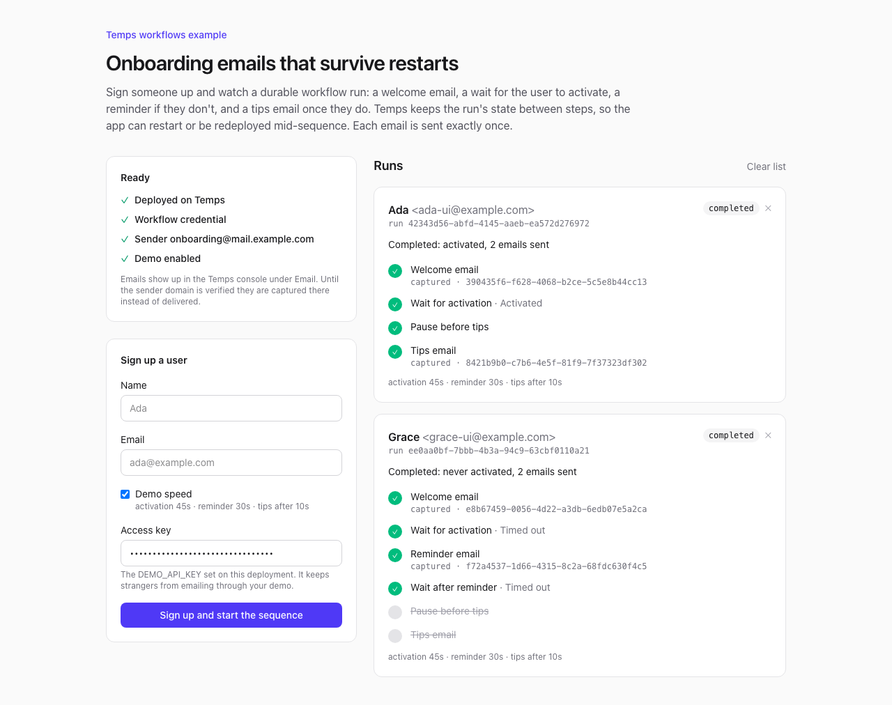

<!--
SPDX-FileCopyrightText: 2024-2026 Temps Contributors
SPDX-License-Identifier: MIT OR Apache-2.0
-->

# Workflows: onboarding emails

A Next.js app that runs a durable onboarding email sequence on **Temps
workflows** (`@temps-sdk/workflows`) and sends through the **Temps email API**.
Sign someone up and watch the run step by step: welcome email, wait for
activation, reminder, tips. There is no queue, no cron and no database: Temps
stores the run and calls the app when the next step is due.



```
signup ──▶ welcome email ──▶ wait for "user.activated" (up to 3 days)
                                │ activated         │ timed out
                                │                   ▼
                                │             reminder email ──▶ wait again (up to 4 days)
                                ▼                                  │ activated     │ timed out
                       sleep 1 day ──▶ tips email ◀─────────────────┘               ▼
                                                                          finish (not activated)
```

| Workflow primitive | Where |
|---|---|
| `ctx.step` with retries and a timeout, around each send | `send-welcome`, `send-reminder`, `send-tips` |
| `ctx.waitForEvent` with a key and a timeout | `wait-for-activation`, `wait-after-reminder` |
| `ctx.sleep` lasting days | `pause-before-tips` |
| `WorkflowsClient.start` with an idempotency key | `POST /api/signup`: one sequence per user |
| `WorkflowsClient.sendEvent` | the **Activate** button → `POST /api/users/{userId}/activate` |
| `WorkflowsClient.getRun` | each run card polls `GET /api/runs/{runId}` |
| `nextRouteHandlers` adapter | `src/app/.well-known/temps/workflows/[action]/route.ts` |

During a sleep or a wait, no request is open and nothing is held in the app's
memory. The app can restart or be redeployed in the middle of a run, and the
next invocation replays the run's journal and carries on from where it was.

## Sending each email exactly once

A workflow step runs **at least once**: if the container dies after the email
went out but before the step was recorded, the step runs again. So the mailer
(`src/lib/mailer.ts`) sends every email with an `Idempotency-Key` derived from
the run and the step (`wf:<runId>:<step>`). Temps stores the key before it
calls the provider, and a retried step gets the first delivery back instead of
sending a second email.

Errors are split in two:

- **Transient** (HTTP 408, 429, 5xx, network): the step throws and is retried
  with backoff, reusing the same key.
- **Permanent** (any other 4xx, such as a sender domain not allowed for the
  project): the step records the rejection instead of retrying, and the run
  fails with the reason. The run card shows it on the failed step.

## Deploy on Temps

1. **Create a project** from this directory. It has a `Dockerfile` (Next.js
   standalone output) on port `3000`; set the health check to `/api/health`.
2. **Issue a workflow credential**: console → project → **Workflows** →
   *Create credential*. Store it as the secret environment variable
   `TEMPS_WORKFLOWS_TOKEN`.
3. **Set up a sender**: under **Email → Domains**, add the domain you send from
   and allow it for this project, then set `EMAIL_FROM` (e.g.
   `onboarding@mail.example.com`). Until that domain is verified, Temps
   **captures** the emails (readable under **Email** in the console) instead of
   delivering them, which is ideal for trying this out.
4. **Set `DEMO_API_KEY`** to any random string. The page asks for it. Without
   it the demo is off, so a deployed copy can't be used to email arbitrary
   addresses.
5. **Deploy**, then open the app. The *Ready* card checks the configuration and
   says what is missing.

Temps injects `TEMPS_API_URL` and `TEMPS_API_TOKEN` (the deployment token) into
every deployment; the mailer uses them to call `POST /emails`.

### Try it

1. Keep **Demo speed** on (45 s to activate, 30 s after the reminder, 10 s
   before the tips) and sign up two users.
2. Click **Activate** on one. It pauses, then gets the tips email.
3. Leave the other alone. After 45 s it gets the reminder; 30 s later the run
   finishes without activation.
4. In the Temps console, **Workflows** shows each run's journal, and **Email**
   shows every message the runs sent.

To see a run survive a redeploy, turn **Demo speed** off (3 days to activate),
sign someone up, redeploy, and click **Activate**: the new container finishes
the run, and the welcome email is not sent again.

## How the page follows a run

The app-facing workflows API returns a run's status, plus its output once it
has finished, but not its journal. While a run is in flight,
`src/lib/timeline.ts` derives the timeline from the status, the configured
timings and the activation this browser sent. Once the run finishes, the
output is authoritative: it lists every email the run actually sent, with its
Temps email id. The console's run page always shows the exact journal.

The list of runs lives in the browser's `localStorage`; their state lives in
Temps. Reload the page, or close it in the middle of a run, and it picks up
where the runs are.

Keep personal data out of event keys and workflow names, because Temps stores
those in plaintext. The user id is the event key here; the email address only
travels in the run input, which Temps encrypts.

## Develop and test

```bash
npm install
npm test          # the workflow on the SDK's in-memory orchestrator, plus the timeline
npm run typecheck
npm run dev       # the page; set TEMPS_API_URL, TEMPS_WORKFLOWS_TOKEN, … from .env.example
```

`npm test` runs the real workflow on a virtual clock, so days pass instantly.
It covers every branch of the sequence, checks that replays never resend an
email, that a transient failure is retried with the same idempotency key, and
that a rejected email fails the run once. It also tests the timeline for each
stage. It uses Node's built-in test runner on the TypeScript sources (Node
22.6 or later).

### End to end against a deployment

```bash
APP_URL=https://<your-app-url> DEMO_API_KEY=<key> npm run e2e
```

`scripts/e2e.mjs` checks the setup, then signs up two users with timings in
seconds. One activates and gets *welcome + tips*; the other never activates and
gets *welcome + reminder*. It also checks that a repeated signup returns the
same run, that the event wakes exactly one run, and that every email went
through Temps.

## The SDK package

`@temps-sdk/workflows` is not published to npm yet, so this example vendors the
SDK as `vendor/temps-sdk-workflows-0.1.0.tgz`, built from
[`sdks/node/packages/workflows`](https://github.com/gotempsh/temps/tree/main/sdks/node/packages/workflows)
the same way `temps workflows init --sdk-package` does. Once it is published,
replace the `file:` dependency in `package.json` with a version.

## Files

| File | |
|---|---|
| `src/lib/onboarding.ts` | the workflow definition |
| `src/lib/mailer.ts` | Temps email API client: idempotency keys, transient vs permanent errors |
| `src/lib/templates.ts` | the three emails |
| `src/lib/timing.ts` | production and demo timings |
| `src/lib/timeline.ts` | what the page draws for a run |
| `src/lib/server.ts` | the executor handler, the workflows client, the demo access check |
| `src/app/.well-known/temps/workflows/[action]/route.ts` | the executor endpoints Temps calls |
| `src/app/api/*` | signup, activate, run status, setup status, health |
| `src/components/OnboardingDemo.tsx` | the page |
| `test/*.test.ts` | unit tests |
| `scripts/e2e.mjs` | end-to-end check against a deployment |
